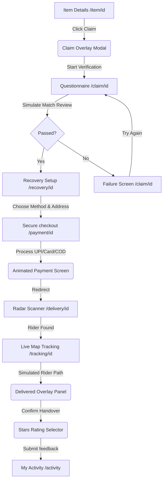

# FoundBack - Recovery Checkout & Delivery Tracking Walkthrough (Phases 4, 5 & 6)

We have successfully designed and built the complete, interactive recovery checkout workflow. This covers item galleries, security-oriented questionnaires, payment simulation processing, delivery partner assignment, and real-time live map tracking.

---

## Complete User Journey Architecture

The following diagram maps out the client-side state machine implemented across these screens:



---

## Detailed Screen Specifications

### 1. Rebuilt Item Details & Multi-Photo Gallery (`/item/[id]`)
- **Interactive Thumbnails**: Includes a crop-shifting Unsplash URL simulation. Users can select thumbnails to update the main view, featuring smooth Framer Motion crossfades.
- **Image Zoo & Modal**: Supports a hover zoom effect on the main image and expands into a full-screen image gallery slideshow upon click.
- **Claim Gateway**: Opens a modal highlighting safety checks and redirects to the claim forms.
- **Save Status Toggle**: Clicking "Save Item" updates `localStorage` and changes state to `Saved ✓`.

### 2.Ownership Verification Wizard (`/claim/[id]`)
- **Progress Stepper**: Guides the user through: Confirming Item $\rightarrow$ Category-specific Questions $\rightarrow$ Optional Invoice/receipt evidence file attachments $\rightarrow$ Review.
- **Category-specific Questions**: Custom text areas are served based on category (AirPods, bags, wallets, keys).
- **Matching Diagnostics**: When "Submit" is clicked, a custom SVG indicator counts from 0% to 100% (cycling through check stages). If the user inputs `"fail"` in details, they land on a failure screen; otherwise, they get verified with a unique Recovery ID: `FB-REC-48291`.

### 3. Recovery Options & Setup Checkout (`/recovery/[id]`)
- **Fulfillment Choice**: Pick between "Pick Up Myself" (which reveals public handover safety guides) and "Deliver to Me" (highlighted as recommended).
- **Auto-Fill Address**: A "Use saved address" quick-action link populates societies and pincodes for Indirapuram, Ghaziabad instantly.
- **Calculations Invoice**: Interactively updates platform, delivery, and recovery fees (₹148 total) and renders a small map layout preview.

### 4. Secure Payment Gateway Simulator (`/payment/[id]`)
- **Methods**: Responsive columns displaying tabs for UPI, Card, and Cash on Delivery (COD).
- **Card Validations**: Integrates digit length checking. Shows animated loaders ("Connecting securely..." $\rightarrow$ "Verifying account balance..." $\rightarrow$ "Confirming claim...") and routes to the rider assignment portal.

### 5. Delivery Partner Radar scanning (`/delivery/[id]`)
- **Scanner Pulse**: Displays a radar-styled SVG circle expanding with wave ripples, sweeps a search arm, and pulses mock coordinate dots representing riders.
- **Rider Card Details**: Renders Arjun Kumar with vehicles numbers, average customer ratings, call/chat triggers, and transit ETA times.

### 6. Live Map Tracking & Confetti Completion (`/tracking/[id]`)
- **Moving Rider Coordinates**: Renders an SVG roadmap with pickup points, route markers, and destinations. The rider coordinate marker moves forward along the curve at each step of the simulation.
- **Diagnostic Console**: An unobtrusive cog widget lets evaluators fast-forward stages to speed up testing.
- **Delivered Receipt**: When status reaches `delivered`, canvas-confetti bursts on-screen. Users click "Confirm Received", rate the experience (1 to 5 stars), log reviews, and return to the main dashboard.

---

## Production Build Status

The build script compiles with code 0:
```bash
npm run build
```

**Build Artifact Page Map**:
- `/` (Splash & Onboarding Hero)
- `/activity` (Tab dashboards: Lost, Found, active Claim tracking stats)
- `/auth` (Tab form verification)
- `/location` (Location coordinates)
- `/search` (Recent history query matching)
- `/explore` (Filters sidebars)
- `/item/[id]` (Dynamic gallery)
- `/claim/[id]` (Dynamic verification)
- `/recovery/[id]` (Address checkout)
- `/payment/[id]` (Simulated gateways)
- `/delivery/[id]` (Pulsing radar scanner)
- `/tracking/[id]` (Live map movement & Ratings)
