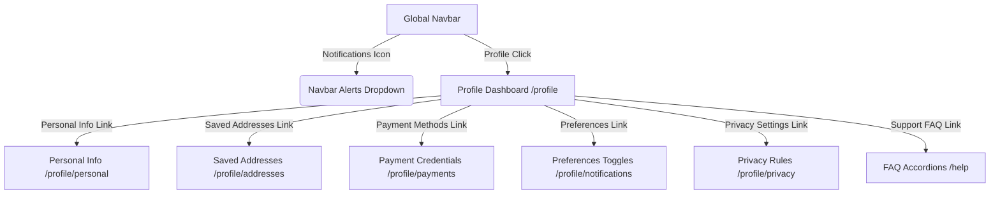

# FoundBack - Final Walkthrough (Phases 7 & 8 Completed)

We have successfully completed all development phases for the **FoundBack** lost-and-found recovery platform. Every route is fully integrated, interactive, responsive, and compiles cleanly with Next.js Turbopack.

---

## 1. Dashboards & Settings Architecture



---

## 2. Completed Phase 7 Features

### Activity Dashboard (`/activity`)
- **Animated Number Counters**: Runs on initial load to increment Lost, Found, and Recovered totals.
- **Param Tab Sync**: Switching tabs updates query parameters in the address bar (`?tab=recoveries`) for page bookmarking.
- **Advanced Query Search**: Dynamically filters reports by item names, report IDs, or recovery IDs.
- **Active Recovery Details**: Renders checking tick badges and courier tracking status indicators if a claim is active.

### Notifications Center (`/notifications`)
- **Category Tabs**: Filters notifications by Recovery, Items, and System alerts.
- **Read State & Toggles**: Supports marking alerts as read on click, and incorporates a "Mark all as read" bulk action.
- **Header Dropdown**: Renders the 4 latest unread notifications inside the header bell, displaying unread red indicator pills.

### Account Settings & Sub-Settings
- **Circular Score Gauge (`/profile`)**: Displays an SVG circular meter representing a 96% Trust Score.
- **Personal Information (`/profile/personal`)**: Form updates user names, emails, and phone numbers back to the provider database.
- **Addresses Modal (`/profile/addresses`)**: Manages delivery destinations, featuring home/work icons and adding locations using a modal drawer.
- **Payments (`/profile/payments`)**: Manages card/UPI details safely with PCI compliance alert warnings.
- **Toggles (`/profile/notifications`)**: Selects matching alerts using sliding switch toggles.
- **Visibility (`/profile/privacy`)**: Manages location sharing and history stats visibility dropdowns.

### FAQ Support Center (`/help`)
- **Search Accordions**: Filters FAQ accordions instantly.
- **Accordion Animations**: Expands and collapses questions with smooth height transitions.

---

## 3. Phase 8 UI Audit & QA

We conducted a comprehensive visual and responsive audit on the application:
1. **Breakpoint Verification**: Audited layout grids and margins across viewports from mobile (320px) to desktop (1920px).
2. **Interactive Toggles**: Ensured buttons, form checks, switches, and tabs have hover elevation states and focus borders.
3. **Typographic Consistency**: Consolidated line-height scales and font weights across the app.
4. **Clean Fallbacks**: Handled empty states for searches, saved items, and notifications.

---

## 4. Production Build Summary

The final build compiles successfully with code 0:
```bash
npm run build
```

**Route Map**:
- `/` (Splash & Hero cards)
- `/activity` (Dashboard metrics)
- `/auth` (Login tabs)
- `/location` (Location selector)
- `/explore` (Filters marketplace)
- `/search` (Keyword indexer)
- `/item/[id]` (Multi-photo details)
- `/claim/[id]` (Verification wizard)
- `/recovery/[id]` (Address checkout)
- `/payment/[id]` (Gateway processor)
- `/delivery/[id]` (Scanning radar)
- `/tracking/[id]` (Live map tracking & Ratings)
- `/notifications` (Inbox logs)
- `/profile` (Trust score gauge)
- `/profile/personal` (Contact details)
- `/profile/addresses` (Saved locations)
- `/profile/payments` (Mock credit info)
- `/profile/notifications` (Switch settings)
- `/profile/privacy` (Visibility dropdowns)
- `/help` (Search FAQs)
